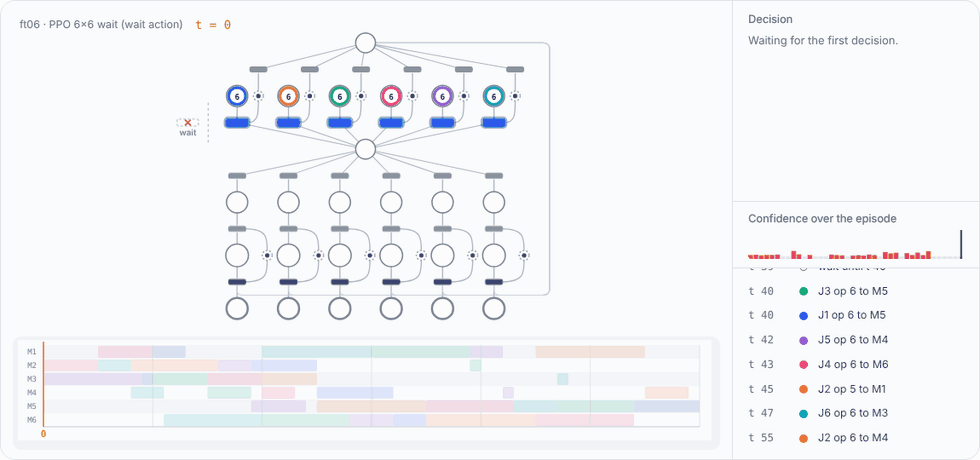

# PetriRL: Explainable Reinforcement Learning with Petri Nets  

**PetriRL** is a research framework that integrates **Colored-Timed Petri Nets (CTPNs)** with **Reinforcement Learning (RL)** to solve complex scheduling and optimization problems in **Discrete Event Systems (DES)**, from the **Job Shop Scheduling Problem (JSSP)** to **Flexible Manufacturing Systems (FMS)** and beyond.  

Developed as part of my PhD on *Explainable Model-Based Reinforcement Learning for Discrete Event Systems* at South Westphalia University of Applied Sciences (FH SWF), PetriRL provides a **formal, modular, and reproducible** approach to dynamic scheduling, intralogistics, and decision-making under uncertainty.  

## Core Idea  

PetriRL bridges **Petri net modeling** and **RL-based decision-making**:  

- **Petri Nets** provide formal semantics, modular scalability, and explainability via token flow and graphical structure.  
- **Event-based RL**: the agent is called only when a decision is possible; between decisions the net fires its automatic and timed transitions and the clock jumps to the next event.  
- **Reinforcement Learning** provides adaptability, generalization, and efficient online decision-making under dynamic conditions.  
- **Dynamic Action Masking** (from Petri net guard functions) reduces the RL action space, improving sample efficiency and convergence.  

This combination enables **interpretable, scalable, and high-performing RL agents** for scheduling, dispatching, and optimization in discrete event systems.  

---

## PetriRL Studio  

[**PetriRL Studio**](https://github.com/Sofiene-Uni/PetriRL-Studio) is a web application on top of the PetriRL environments: train and use agents without writing code, and watch what they do.  



- **Solve** your own instances (drag and drop) or the 242 classic job shop benchmarks, and compare agents and dispatching rules by their gap to the optimum or best known solution.  
- **Replay** an episode firing by firing on the Petri net, synced with an interactive Gantt chart, with the enabled and masked actions at each decision and the policy's probabilities and confidence.  
- **Train** MaskablePPO agents in the dispatching or the hyper-heuristic environment and follow the learning curve live.  

Code, installation and documentation: [github.com/Sofiene-Uni/PetriRL-Studio](https://github.com/Sofiene-Uni/PetriRL-Studio)  

---

## PetriRL Gymnasium Environments  

The PetriRL framework is organized into multiple environments, each targeting a different class of problems:  

- 🔹 [**PetriRL Intralogistics**](https://github.com/Sofiene-Uni/PetriRL_Intralogistics)  
  *Dynamic scheduling of AGVs, tool sharing, and shop floor optimization in Flexible Manufacturing Systems.*  

- 🔹 [**PetriRL Hyperheuristics**](https://github.com/Sofiene-Uni/PetriRL_Hyperheuristic) *(Planned for 2026)*  
  *A hyper-heuristic framework where RL learns to combine and select dispatching rules for adaptive scheduling.*  

- 🔹 [**PetriRL DJSSP**](https://github.com/Sofiene-Uni/PetriRL_DJSSP) *(Planned for 2027)*  
  *Dynamic Job Shop Scheduling Problem (DJSSP) with machine breakdowns, variable job arrivals, and stochastic environments.*  

- 🔹 [**PetriRL Revisiting Masking**](https://github.com/Sofiene-Uni/PetriRL-Masking) *(Planned for 2027)*  
  *Revisits action masking in highly constrained systems: hard masking compared with gradient-based masking of invalid actions.*  

- 🔹 [**PetriRL Multi-Objective Optimization**](#) *(Planned 2028)*  
  *Combines expert agents and actor-critic RL to solve scheduling problems with multiple objectives (e.g., makespan, tardiness, energy consumption).*  

Each environment is **OpenAI Gym-compatible**, comes with **benchmarks** (Taillard + custom large-scale instances), and is designed for **reproducibility and extension**.  

---

## Why PetriRL?  

✔ **Explainable**: Token flows provide a clear semantic interpretation of RL decisions.  
✔ **Scalable**: Modular Petri net design supports complex and large-scale systems.  
✔ **Efficient**: Action masking reduces search space and improves training efficiency.  
✔ **Adaptive**: RL agents generalize to unseen problems and adapt to disruptions in real time.  
✔ **Research-Ready**: Benchmarks, reproducible pipelines, and Gym compatibility.  

---

## Installation  

Install the core PetriRL package via pip:  

```bash
pip install petrirl
```
---

## Research Context  

PetriRL has been applied to:  
- Flexible Manufacturing Systems intralogistics (AGV + tool sharing).  
- Dynamic job shop scheduling with stochasticity.  
- RL-based hyperheuristics for dispatching rule selection.  
- Action masking in highly constrained systems.  
- Multi-objective optimization in scheduling.  

These works are part of my PhD and published in international journals:  

- **Flexible Manufacturing Systems intralogistics: Dynamic optimization of AGVs and tool sharing using Colored-Timed Petri Nets and actor–critic RL with actions masking**  
  [ScienceDirect Link](https://www.sciencedirect.com/science/article/pii/S0278612525001694)  

- **Introducing PetriRL: An innovative framework for JSSP resolution integrating Petri nets and event-based reinforcement learning**  
  [ScienceDirect Link](https://www.sciencedirect.com/science/article/pii/S0278612524000943)  

---

## Citation  

PetriRL and PetriRL Studio were developed by **Sofiene Lassoued** during his PhD at **South Westphalia University of Applied Sciences (Fachhochschule Südwestfalen, FH SWF)**. You are welcome to use and extend them; please keep this credit in copies and derived work. If you use this framework, please cite the associated papers:  

```bibtex
@article{lassoued2024petrirl,
  title   = {Introducing PetriRL: An innovative framework for JSSP resolution integrating Petri nets and event-based reinforcement learning},
  author  = {Lassoued, Sofiene and Schwung, Andreas},
  journal = {Journal of Manufacturing Systems},
  volume  = {74},
  pages   = {690--702},
  year    = {2024},
  issn    = {0278-6125},
  doi     = {10.1016/j.jmsy.2024.04.028},
  url     = {https://www.sciencedirect.com/science/article/pii/S0278612524000943}
}

@article{lassoued2025intralogistics,
  title   = {Flexible Manufacturing Systems intralogistics: Dynamic optimization of AGVs and tool sharing using Colored-Timed Petri Nets and actor--critic RL with actions masking},
  author  = {Lassoued, Sofiene and Baheti, Laxmikant Shrikant and Weiß-Borkowski, Nathalie and Lier, Stefan and Schwung, Andreas},
  journal = {Journal of Manufacturing Systems},
  volume  = {82},
  pages   = {405--419},
  year    = {2025},
  issn    = {0278-6125},
  doi     = {10.1016/j.jmsy.2025.06.017},
  url     = {https://www.sciencedirect.com/science/article/pii/S0278612525001694}
}
```

---

## Contributions  

This repository provides the **main entry point** to PetriRL, including:  
- The **core PetriRL package** (`pip install petrirl`).  
- Links to specialized environments.  
- The **PetriRL Studio** web application ([repository](https://github.com/Sofiene-Uni/PetriRL-Studio)).  
- Documentation and research context.  
- Benchmarks and reproducible pipelines for evaluation.  
